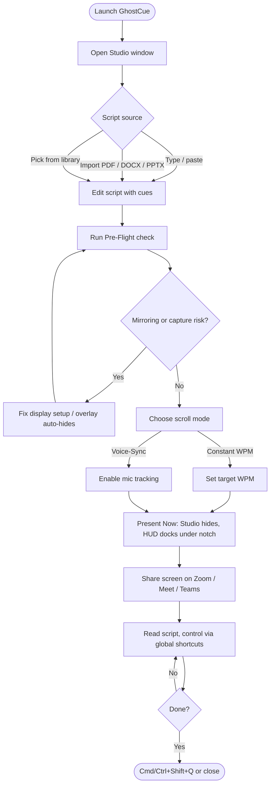
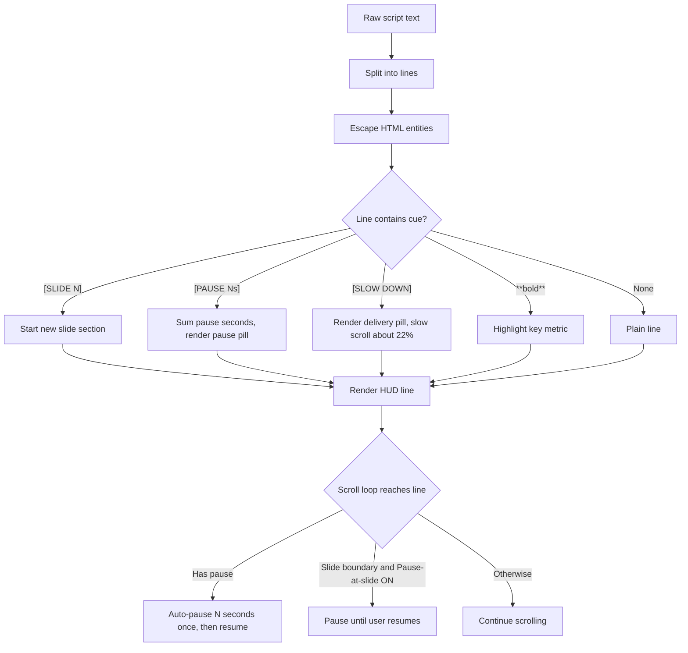
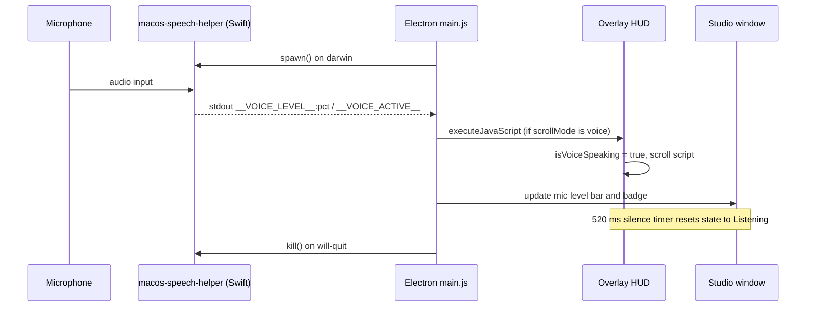
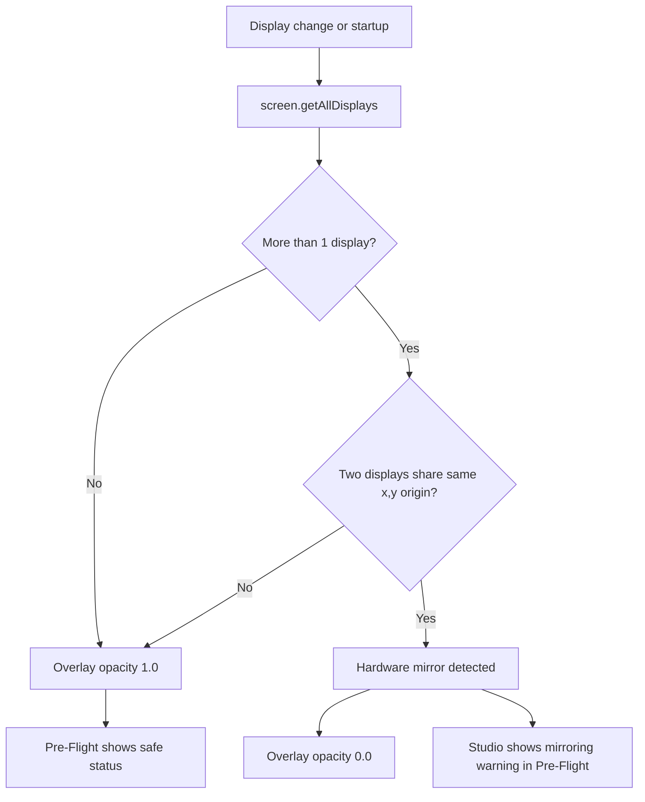
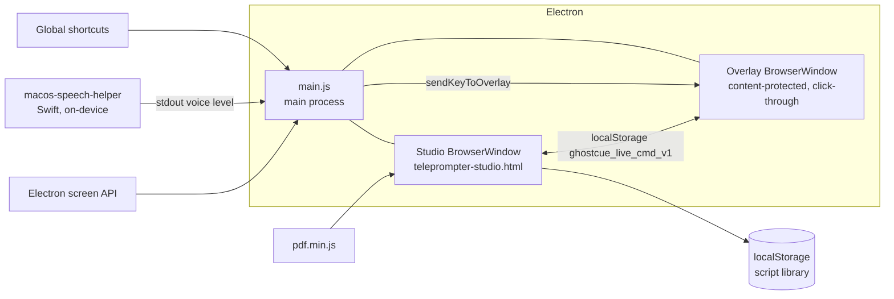
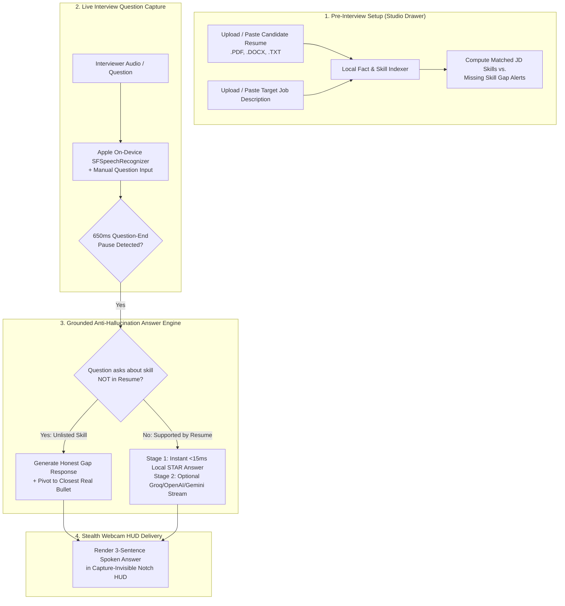

# GhostCue — Flowcharts & Diagrams

Standalone sources live in [diagrams/](diagrams/). They are embedded here so GitHub renders them.

## 1. Presenter session flow

## 2. Script cue processing

## 3. Voice-sync pipeline

## 4. Mirror safety & pre-flight

## 5. Architecture

## 6. Phase 2 — AI Interview Co-Pilot Pipeline

